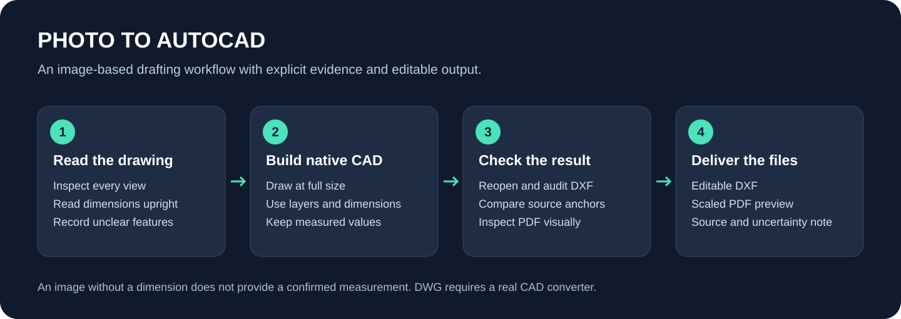
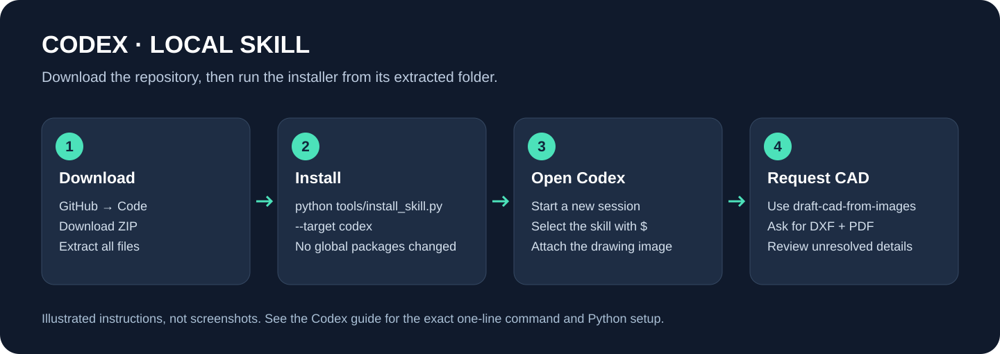
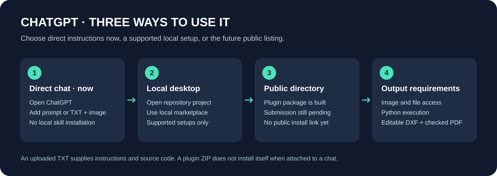
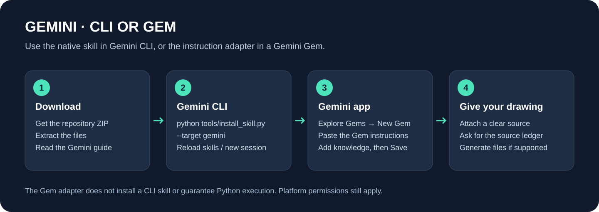
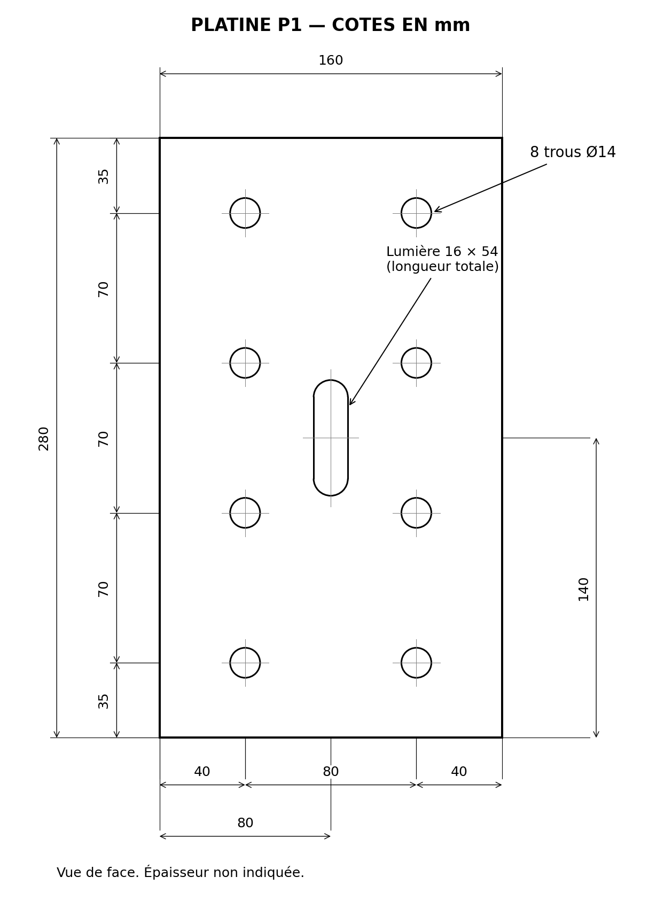
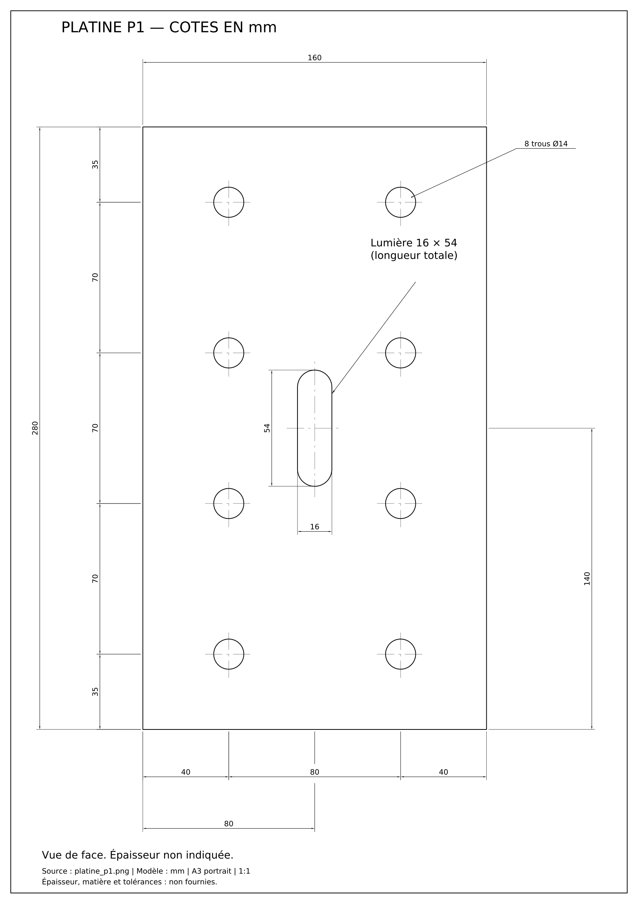

# Photo to AutoCAD

[الدارجة / العربية](README.md) · [Français](README.fr.md)

An agent skill for reconstructing photographed technical drawings as editable, dimensioned **DXF**, with a **PDF preview** and a record of unclear source information. It includes CAD helpers, validation, an installer and illustrated guides.



## Download and install

[Download the complete 1.0.0 package](https://raw.githubusercontent.com/mouniranna-ui/my-name/photo-to-autocad/downloads/photo-to-autocad-source-1.0.0.zip) and extract the complete folder. Separate [skill](https://raw.githubusercontent.com/mouniranna-ui/my-name/photo-to-autocad/downloads/photo-to-autocad-skill-1.0.0.zip), [plugin](https://raw.githubusercontent.com/mouniranna-ui/my-name/photo-to-autocad/downloads/photo-to-autocad-plugin-1.0.0.zip) and [checksums](https://raw.githubusercontent.com/mouniranna-ui/my-name/photo-to-autocad/downloads/SHA256SUMS.txt) are also available. Read the code before running it.

The project is published on the [`photo-to-autocad` branch](https://github.com/mouniranna-ui/my-name/tree/photo-to-autocad). Keep that branch selected when using **Code → Download ZIP**, or clone it directly:

```bash
git clone --branch photo-to-autocad --single-branch https://github.com/mouniranna-ui/my-name.git photo-to-autocad
cd photo-to-autocad
```

From the extracted repository:

```bash
python tools/install_skill.py --target codex
```

Use `python3` on systems where `python` is unavailable, or `py -3` on Windows. The installer only copies the skill. It makes no network requests and does not install Python packages. Existing changes require `--replace`, which keeps a backup outside the skills directory.

Open a new Codex session, attach the drawing and ask:

```text
Use $draft-cad-from-images to redraw this image as editable DXF with all
readable dimensions and labels. Include a PDF preview and identify unknowns.
```



## Choose a platform

| Platform | Use this route |
| --- | --- |
| Codex CLI / local / IDE | The installer above; it copies to `~/.agents/skills/` |
| Codex cloud | Install with `--scope project` in the connected repository/environment; provide Python dependencies and the image |
| ChatGPT desktop / Codex desktop | Open this repository as a project; use its `.agents/plugins/marketplace.json` in a supported local marketplace setup |
| ChatGPT web / mobile | Copy `prompts/chatgpt-instructions.txt` into a chat and attach the drawing; file generation requires actual code execution tools |
| Gemini CLI | Run `python tools/install_skill.py --target gemini`, then open a new session or use `/skills reload` |
| Gemini app / Gems | Create a Gem, paste `prompts/gemini-gem-instructions.txt`, optionally attach `prompts/portable-knowledge.txt`, and Save |
| Other assistants | Use `prompts/portable-instructions.txt`; they need image access and code execution for actual CAD files |

A Gem instruction adapter is not a native CLI skill installation. Uploading a ZIP to an ordinary ChatGPT chat is not plugin installation. GitHub distribution does not itself publish an entry in the public Plugins Directory. If execution is unavailable, the assistant should provide a source ledger and runnable generation code instead of claiming to have produced files.




## Python setup

Use Python 3.10+. Create a project environment with `python -m venv .venv`. Activate it using `source .venv/bin/activate` on macOS/Linux, `.venv\Scripts\activate.bat` in Windows CMD, or `.\.venv\Scripts\Activate.ps1` in PowerShell. You can also invoke the environment's Python directly.

```bash
python -m pip install -r requirements.txt
python tools/cad.py doctor
python tools/cad.py example --output-dir demo-output
```

The example command checks the helper workflow using fixed synthetic geometry; it is not an automatic image tracer.

## Inspect a worked example

| Synthetic source | Actual DXF-derived preview |
| --- | --- |
|  |  |

[Editable DXF](examples/plate/drawing.dxf) · [PDF](examples/plate/preview.pdf)

The plate is 160 × 280 mm with eight Ø14 holes and a 16 × 54 mm slot. Fifteen native dimensions were checked. Thickness, material and manufacturing tolerances remain unspecified. The output was audited and visually reviewed; it was not tested in the Autodesk AutoCAD application.

## Scope and development

DXF is the portable default. Genuine DWG needs AutoCAD or a real CAD converter; never rename a DXF extension. The skill does not provide AutoCAD, licensing, structural design certification, or confirmed dimensions missing from the image.

```bash
python -m pip install -r requirements-dev.txt
python tools/verify_repository.py
python -m unittest discover -s tests -v
python plugins/photo-to-autocad/skills/draft-cad-from-images/scripts/test_cad_tools.py
python tools/build_release.py
```

[Platform guides](docs/INSTALL_CODEX.md) · [Troubleshooting](docs/TROUBLESHOOTING.md) · [Evidence](docs/VERIFICATION.md) · [Official sources](docs/SOURCES.md)

Code and instructions: [MIT](LICENSE). Independent project, unaffiliated with Autodesk, OpenAI or Google. See [NOTICE](NOTICE.md) for branding and examples.
