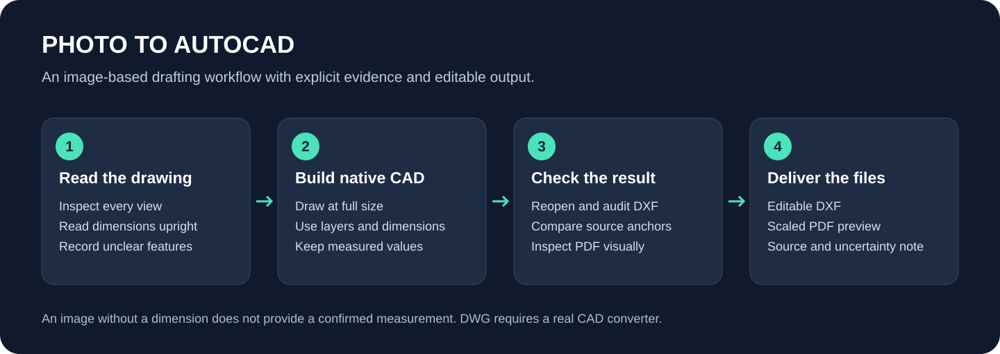
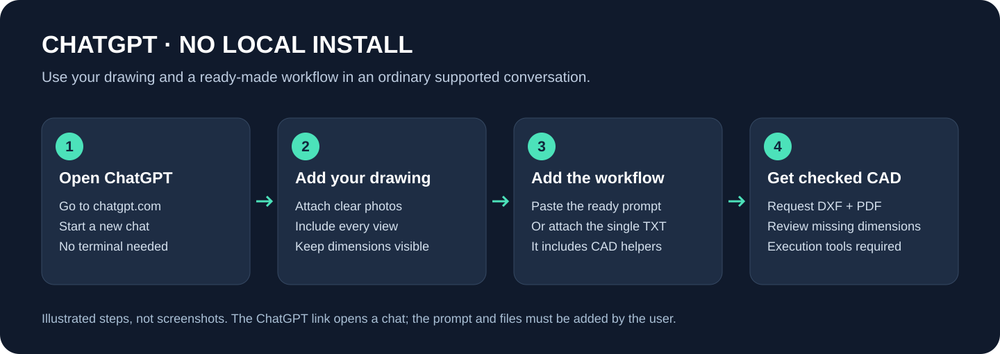
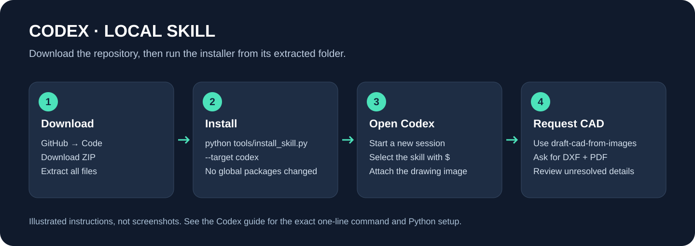
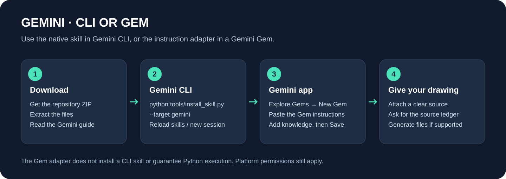
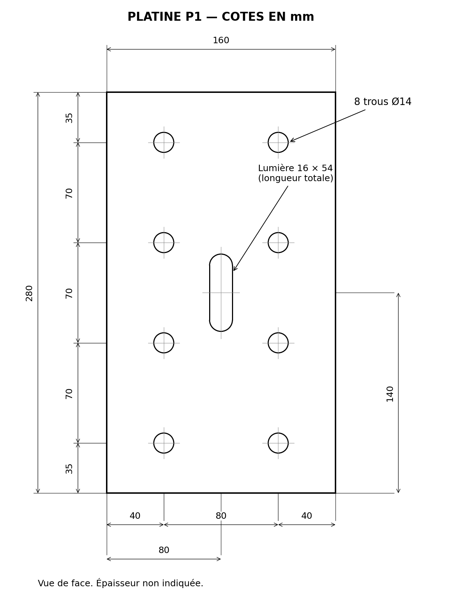
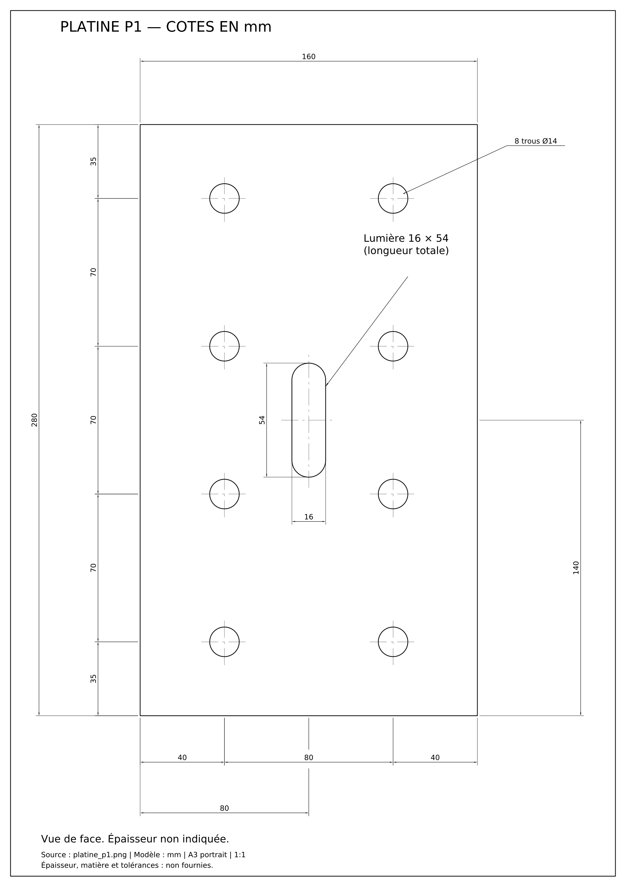

# Photo to AutoCAD

[الدارجة / العربية](README.md) · [English](README.en.md)

Une skill pour reconstruire des dessins techniques photographiés en **DXF modifiable**, avec cotations natives, calques, textes et aperçu PDF. Les dimensions lisibles, calculées et inconnues restent distinctes.



## Utilisation directe dans ChatGPT

**[Ouvrir ChatGPT](https://chatgpt.com/)** et joindre le dessin avec [Photo-to-AutoCAD-ChatGPT.txt](https://raw.githubusercontent.com/mouniranna-ui/my-name/photo-to-autocad/prompts/Photo-to-AutoCAD-ChatGPT.txt). Ce fichier unique contient les instructions, les références, les dépendances et le code des outils CAO. Écrire : **« Suis le fichier Photo to AutoCAD joint et produis un DXF modifiable avec toutes les cotes lisibles et un PDF vérifié. »** Aucune installation locale ni terminal n'est nécessaire. La génération des fichiers exige que la conversation puisse lire les images, exécuter Python et retourner des fichiers.

[Guide illustré](docs/CHATGPT_START.md) · [État de publication du plugin](docs/PLUGIN_PUBLICATION.md). Le ZIP du plugin est disponible ; sa publication dans l'annuaire public ChatGPT n'est pas encore effectuée.




## Télécharger et utiliser

[Télécharger la version complète 1.1.0](https://raw.githubusercontent.com/mouniranna-ui/my-name/photo-to-autocad/downloads/photo-to-autocad-source-1.1.0.zip), puis extraire le dossier complet. Le projet est publié sur la [branche `photo-to-autocad`](https://github.com/mouniranna-ui/my-name/tree/photo-to-autocad) : garder cette branche sélectionnée pour **Code → Download ZIP**. Ouvrir un terminal dans le dossier extrait. Python 3.10 ou ultérieur est nécessaire pour les outils CAD.

Avec Git :

```bash
git clone --branch photo-to-autocad --single-branch https://github.com/mouniranna-ui/my-name.git photo-to-autocad
cd photo-to-autocad
```

### Codex

```bash
python tools/install_skill.py --target codex
```

Ouvrir une nouvelle session, joindre le dessin et demander :

```text
Utilise $draft-cad-from-images pour redessiner cette image en DXF modifiable.
Conserve les cotes et annotations lisibles, ajoute un PDF et signale les inconnues.
```

### Gemini CLI

```bash
python tools/install_skill.py --target gemini
```

Ouvrir une nouvelle session ou exécuter `/skills reload`, puis demander d'utiliser `draft-cad-from-images` sur l'image jointe.

### ChatGPT et Gemini dans le navigateur

Pour ChatGPT, copier [les instructions](prompts/chatgpt-instructions.txt) dans la conversation et joindre le dessin. Pour Gemini, créer un Gem avec [les instructions dédiées](prompts/gemini-gem-instructions.txt), puis enregistrer. Le fichier [portable-knowledge.txt](prompts/portable-knowledge.txt) fournit le contexte technique.

Ces méthodes ne garantissent pas l'exécution de Python. Sans outils d'exécution, demander le relevé des cotes et un programme complet à lancer localement. Un ZIP joint à une conversation n'installe pas un plugin. La distribution GitHub ne constitue pas une publication dans l'annuaire public de plugins.




## Dépendances et exemple

Créer un environnement avec `python -m venv .venv`, puis l'activer. Sur Windows CMD : `.venv\Scripts\activate.bat`. Sur macOS/Linux : `source .venv/bin/activate`.

```bash
python -m pip install -r requirements.txt
python tools/cad.py doctor
python tools/cad.py example --output-dir demo-output
```

Le dernier programme produit un exemple synthétique fixe : l'agent doit encore lire et reconstruire chaque nouveau dessin.

| Image d'exemple | Aperçu produit depuis le DXF |
| --- | --- |
|  |  |

[Télécharger le DXF](examples/plate/drawing.dxf) · [Voir le PDF](examples/plate/preview.pdf)

Pour un DWG, utiliser un vrai logiciel CAD ou convertisseur. Ne pas renommer un DXF. Le projet ne fournit pas AutoCAD et ne certifie pas le dimensionnement structurel.

[Guides détaillés](docs/INSTALL_CODEX.md) · [Sources officielles](docs/SOURCES.md) · [Licence MIT](LICENSE)

Projet indépendant, sans affiliation à Autodesk, OpenAI ou Google. Les noms et marques restent ceux de leurs titulaires.
