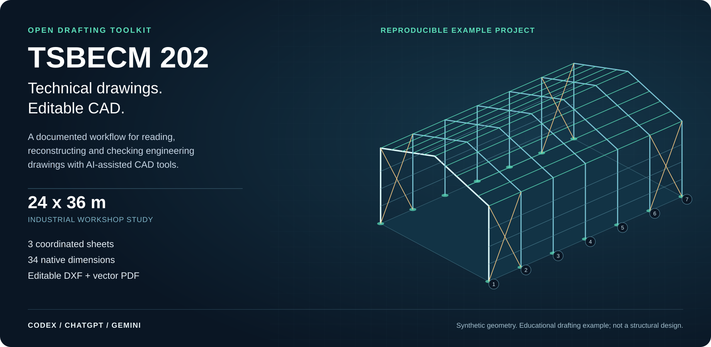
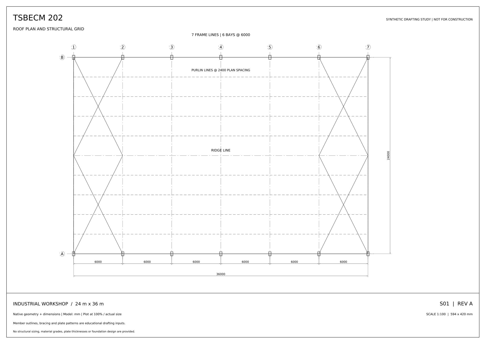
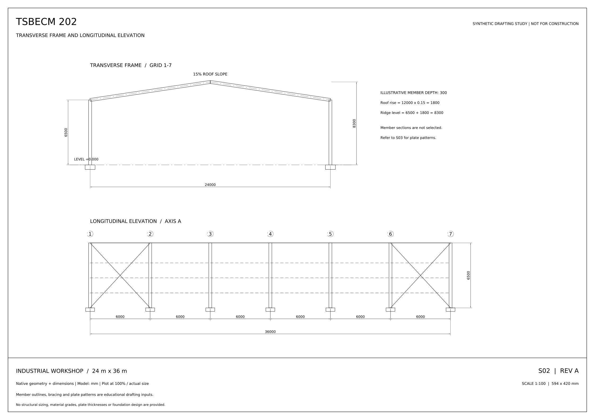
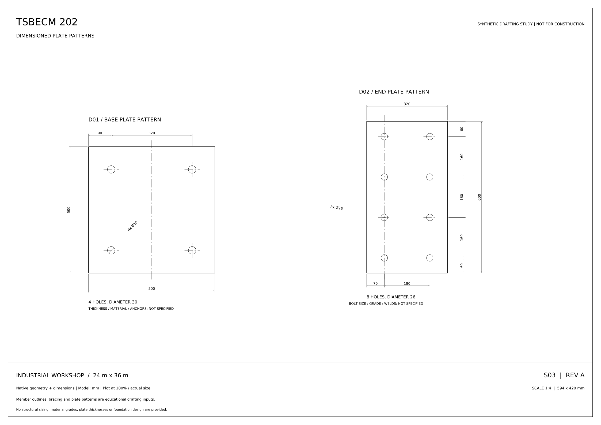

<div align="center">

# TSBECM 202

**From technical drawings to editable CAD.**

An open drafting workflow for students, technicians and detailers. Read a drawing, reconstruct native geometry, verify its dimensions and deliver a clean CAD file with a printable PDF.

[Start in ChatGPT](docs/CHATGPT_START.md) · [Install in Codex](docs/INSTALL_CODEX.md) · [Use Gemini](docs/INSTALL_GEMINI.md) · [Documentation](docs/README.md)

</div>



## What this project does

TSBECM 202 helps an AI assistant turn photographed or scanned technical drawings into **editable 2D DXF**. It provides a structured reading process, CAD generation helpers, native dimension checks and PDF output. The assistant interprets the source and writes the drawing-specific geometry; this is not a one-command automatic image tracer.

| Input | Process | Deliverables |
| --- | --- | --- |
| A legible drawing image, scan or dimensioned brief | Read the source, resolve dimensions, build native CAD, reopen and verify | Editable DXF, scaled PDF, source ledger and uncertainty notes |

**Designed for:** steelwork drawing exercises, connection details, plate patterns, general arrangements and OFPPT/TSBECM drafting practice.

## Start with your platform

| Your setup | Recommended route | Guide |
| --- | --- | --- |
| ChatGPT in a browser or on a phone | Attach one TXT workflow file and your drawing, or paste the ready prompt | [ChatGPT without installation](docs/CHATGPT_START.md) |
| Codex CLI, local environment or IDE | Install the bundled agent skill | [Codex installation](docs/INSTALL_CODEX.md) |
| A supported local ChatGPT/Codex desktop setup | Use the included plugin marketplace | [ChatGPT plugin guide](docs/INSTALL_CHATGPT.md) |
| Gemini CLI | Install the same skill into Gemini's skill directory | [Gemini installation](docs/INSTALL_GEMINI.md) |
| Gemini app or a Gem | Use the instruction and knowledge files | [Gemini guide](docs/INSTALL_GEMINI.md#gemini-app-and-gems) |

Producing actual DXF/PDF files requires image access, Python execution and file output support. If those capabilities are unavailable, the workflow returns a source ledger and runnable code. The downloadable plugin has **not been published in the public ChatGPT Plugins Directory**. [Publication status](docs/PLUGIN_PUBLICATION.md).

## Featured project: industrial workshop

A reproducible **24 m × 36 m educational workshop study**, with seven frame lines and six 6 m bays. It demonstrates a larger, coordinated drawing package rather than a single isolated shape.



| S02 — Elevations | S03 — Plate patterns |
| --- | --- |
|  |  |

**[Open the complete drawing set](examples/industrial-workshop/TSBECM-202_Workshop_Drawing_Set.pdf)** · **[Explore the CAD files and evidence](examples/industrial-workshop/README.md)**

The drawings are generated from a published synthetic specification. They include real CAD geometry and native dimensions, with saved-file audit results. The previews are rendered from the DXF files. They are not AutoCAD screenshots, a client reference or proof of structural adequacy. Member sizing, loads, material grades, plate thicknesses, bolts, welds and foundations are outside this example.

## Download version 2.0.0

| Package | Choose it when |
| --- | --- |
| [Complete project ZIP](https://raw.githubusercontent.com/mouniranna-ui/my-name/photo-to-autocad/downloads/tsbecm-202-source-2.0.0.zip) | You want the documentation, installer, scripts and examples |
| [Standalone skill ZIP](https://raw.githubusercontent.com/mouniranna-ui/my-name/photo-to-autocad/downloads/tsbecm-202-skill-2.0.0.zip) | You want to install the skill manually |
| [Plugin ZIP](https://raw.githubusercontent.com/mouniranna-ui/my-name/photo-to-autocad/downloads/tsbecm-202-plugin-2.0.0.zip) | Your environment supports plugin package ingestion |
| [Single ChatGPT TXT](prompts/TSBECM-202-ChatGPT.txt) | You want to attach the workflow and helper source to a chat |
| [SHA-256 checksums](https://raw.githubusercontent.com/mouniranna-ui/my-name/photo-to-autocad/downloads/SHA256SUMS.txt) | You want to verify the archive bytes |

Use the download button on each GitHub file page. For **Code → Download ZIP**, keep the `photo-to-autocad` branch selected; this branch contains the project. The repository URL is a hosting address, while **TSBECM 202** is the project and plugin name.

```bash
git clone --branch photo-to-autocad --single-branch https://github.com/mouniranna-ui/my-name.git tsbecm-202
cd tsbecm-202
```

## Quick start in ChatGPT

1. Open [ChatGPT](https://chatgpt.com/).
2. Attach [TSBECM-202-ChatGPT.txt](prompts/TSBECM-202-ChatGPT.txt) and clear images of the drawing.
3. Send this request:

```text
Follow the attached TSBECM 202 workflow. Reconstruct my drawing as editable
DXF with native dimensions, organized layers and all readable annotations.
Create a scaled PDF preview, verify the saved geometry, and identify unclear
or missing source information. Return the actual files when execution is available.
```

The TXT file supplies instructions, references and helper source code. It does not install a plugin or add execution capabilities to the account. [Detailed walkthrough](docs/CHATGPT_START.md).

## Quick start in Codex

Run these commands from the extracted project directory:

```bash
python tools/install_skill.py --target codex
python -m venv .venv
```

Activate the environment using the appropriate command:

| System | Command |
| --- | --- |
| Windows PowerShell | `.\.venv\Scripts\Activate.ps1` |
| Windows Command Prompt | `.venv\Scripts\activate.bat` |
| macOS or Linux | `source .venv/bin/activate` |

Then install the CAD dependencies and inspect the environment:

```bash
python -m pip install -r requirements.txt
python tools/cad.py doctor
```

Use `python3` or `py -3` if `python` is unavailable. If PowerShell blocks activation, invoke `.\.venv\Scripts\python.exe` directly. Open a new agent session, attach the drawing and ask:

```text
Use $draft-cad-from-images to create editable DXF and a checked PDF
from this drawing. Preserve readable dimensions and report unknowns.
```

The technical skill name stays `draft-cad-from-images` for compatibility. Its display name is **TSBECM 202**. [Full installation and update guide](docs/INSTALL_CODEX.md).

## How the workflow works


1. **Read the source.** Inspect every view, rotated label, symbol and dimension endpoint.
2. **Record the evidence.** Separate written values, derived values and unresolved information in a source ledger.
3. **Build native CAD.** Use lines, arcs, circles, polylines, text, layers and DIMENSION entities at full model size.
4. **Verify the saved result.** Reopen the DXF, inspect audit errors and compare entity measurements and feature positions with the ledger.
5. **Review the sheet.** Render a scaled PDF and check text, symbols, clipping and dimension placement.
6. **Deliver usable files.** Return CAD, PDF and a concise record of checks and remaining questions.

See the [complete workflow](docs/WORKFLOW.md) for source preparation, handling contradictions, output conventions and review criteria.

## Examples and verification

- [Industrial workshop](examples/industrial-workshop/README.md): coordinated roof plan, elevations and plate patterns from a synthetic brief.
- [Dimensioned plate](examples/plate/README.md): an independent synthetic drawing image with eight holes and a slot.
- [Verification evidence](docs/VERIFICATION.md): what was actually measured, audited and reviewed.
- [Troubleshooting](docs/TROUBLESHOOTING.md): installation, missing dependencies, unreadable dimensions and file output issues.

To reproduce the workshop locally:

```bash
python tools/build_showcase.py --output-dir workshop-output
```

To run the project checks and rebuild the distribution:

```bash
python -m pip install -r requirements-dev.txt
python tools/build_chatgpt_kit.py
python tools/verify_repository.py
python -m unittest discover -s tests -v
python plugins/tsbecm-202/skills/draft-cad-from-images/scripts/test_cad_tools.py
python tools/build_release.py
```

## Project structure

| Location | Contents |
| --- | --- |
| `plugins/tsbecm-202/` | Portable plugin and the drafting skill |
| `docs/` | Platform guides, workflow, verification and support |
| `prompts/` | Copyable instructions and the single ChatGPT attachment |
| `examples/` | Reproducible drawings, previews, source specifications and evidence |
| `tools/` | Installer, CAD entry point, showcase and release builders |
| `tests/` | Distribution regression tests |
| `downloads/` | Versioned archives and checksums |

## Scope, licence and support

DXF is the editable default. A genuine DWG file requires AutoCAD or a working CAD converter; changing a file extension is not conversion. The project does not supply AutoCAD or its licence, and reconstructing a drawing does not certify a structure or confirm missing dimensions.

[MIT licence](LICENSE) · [Attribution](NOTICE.md) · [Support](docs/SUPPORT.md) · [Data flow](docs/DATA_FLOW.md) · [Official references](docs/SOURCES.md) · [Changelog](CHANGELOG.md)

TSBECM 202 is an independent educational project, not an official product or endorsement of Autodesk, OpenAI, Google or OFPPT.
