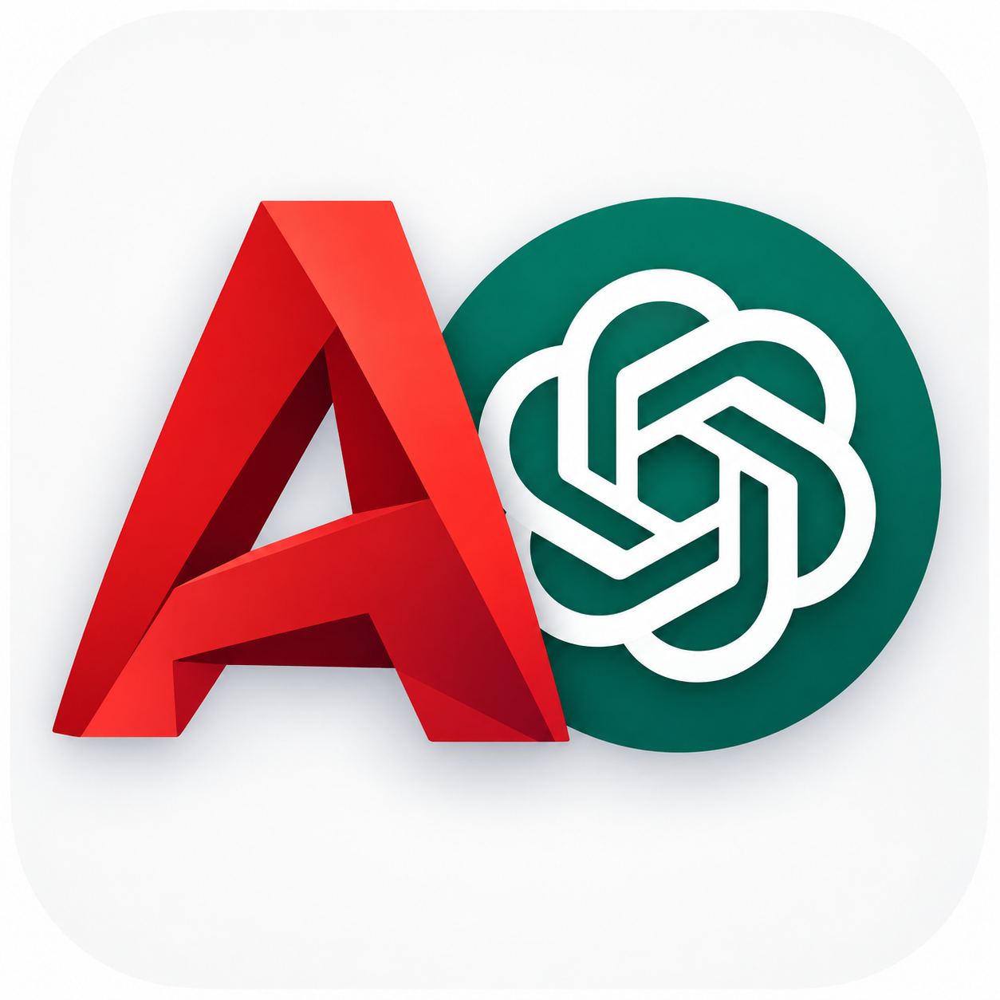
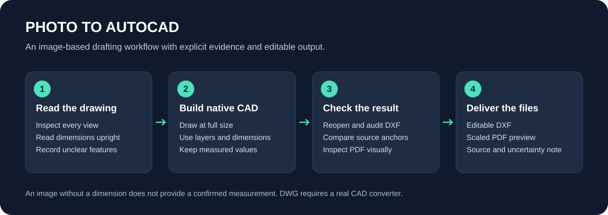
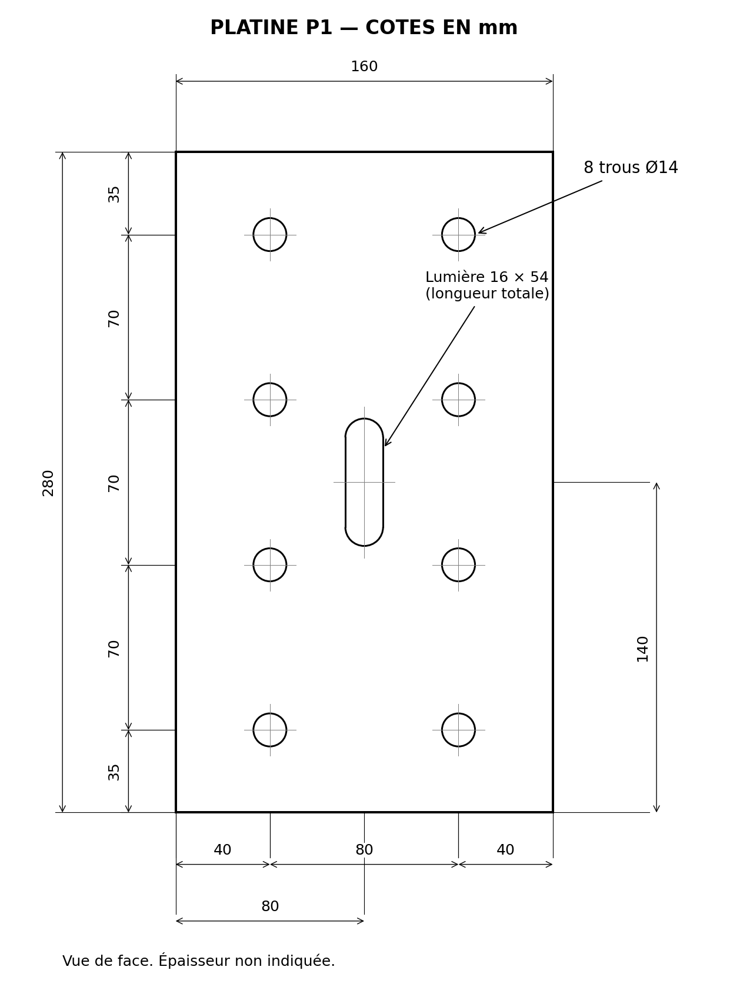
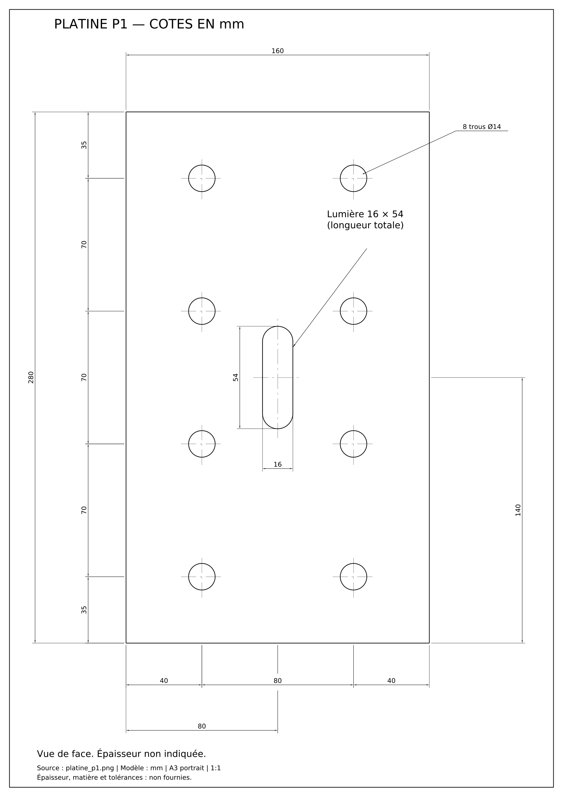
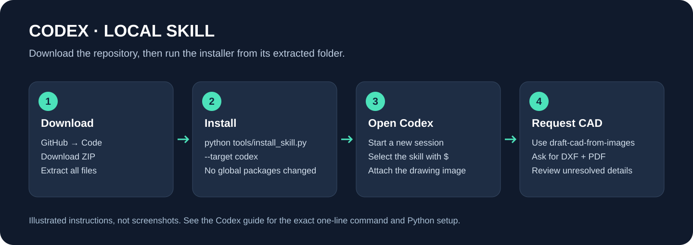

<p align="center">
  
</p>

# Photo to AutoCAD — من الصورة إلى رسم CAD

**[English](README.en.md) · [Français](README.fr.md)**

Skill كتعاون المساعد يقرا صور الرسومات التقنية ويعاود يرسمها فـ**DXF قابل للتعديل**، بالكوطاسيون، الطبقات والعبارات، مع **PDF للمعاينة والطباعة**. كتفرّق بين القياسات المكتوبة، المستنتجة والناقصة.

كتخدم مع Codex وGemini CLI كـskill، ومع ChatGPT وGemini عبر الطرق الموضحة لتحت. خاص المساعد يقدر يقرا الصور ويشغّل Python باش يخرج الملفات فعلياً.



## مثال حقيقي من التجربة

هاد المثال **مصطنع للتجربة**، ماشي مشروع ديال زبون. الصورة الثانية معاينة من DXF، ماشي screenshot من AutoCAD.

| الصورة الأصلية | النتيجة بعد إعادة الرسم |
| --- | --- |
|  |  |

حمّل [ملف DXF ديال المثال](examples/plate/drawing.dxf) أو [PDF](examples/plate/preview.pdf). اللوحة 160 × 280 mm، فيها 8 ثقوب Ø14 وفتحة 16 × 54. تراجعات 15 كوطاسيون أصلية؛ السُّمك والمادة والتفاوتات غير معطاة. [تفاصيل التحقق](docs/VERIFICATION.md).

## التحميل

**[حمّل النسخة الكاملة 1.0.0](https://raw.githubusercontent.com/mouniranna-ui/my-name/photo-to-autocad/downloads/photo-to-autocad-source-1.0.0.zip)**، ومن بعد فك الضغط. احتافظ بالمجلد كامل؛ `SKILL.md` بوحدو ما فيهش أدوات الرسم.

المشروع منشور ففرع [`photo-to-autocad`](https://github.com/mouniranna-ui/my-name/tree/photo-to-autocad). للتحميل من **Code → Download ZIP**، تأكد بلي هاد الفرع هو المختار.

| الملف | الاستعمال |
| --- | --- |
| [النسخة الكاملة](https://raw.githubusercontent.com/mouniranna-ui/my-name/photo-to-autocad/downloads/photo-to-autocad-source-1.0.0.zip) | الشرح، الصور، المثبّت، المثال والأدوات |
| [Skill مستقلة](https://raw.githubusercontent.com/mouniranna-ui/my-name/photo-to-autocad/downloads/photo-to-autocad-skill-1.0.0.zip) | مجلد skill للنسخ اليدوي |
| [حزمة Plugin](https://raw.githubusercontent.com/mouniranna-ui/my-name/photo-to-autocad/downloads/photo-to-autocad-plugin-1.0.0.zip) | للمنصات اللي كتدعم استيراد الحزم |
| [SHA256SUMS.txt](https://raw.githubusercontent.com/mouniranna-ui/my-name/photo-to-autocad/downloads/SHA256SUMS.txt) | بصمات التحقق من الملفات |

للي كيستعمل Git:

```bash
git clone --branch photo-to-autocad --single-branch https://github.com/mouniranna-ui/my-name.git photo-to-autocad
cd photo-to-autocad
```

## شنو تختار؟

| المنصة | الطريقة | إنتاج الملفات |
| --- | --- | --- |
| Codex CLI / بيئة محلية / IDE | تثبيت skill محلية | نعم، إلا توفرت قراءة الصور وPython والمكتبات |
| ChatGPT desktop / Codex desktop | Plugin من marketplace محلي | حسب أدوات وصلاحيات البيئة |
| ChatGPT فالويب أو الهاتف | تعليمات محمولة + الصور؛ أو Plugin منشور ومتاح للحساب | حسب إمكانية تشغيل الكود وإرجاع الملفات |
| Gemini CLI | skill محلية أو تثبيت من Git | نعم، مع نفس متطلبات Python |
| Gemini app / Gem | تعليمات Gem + ملفات معرفة | ماشي ضمان لتشغيل Python؛ يقدر يخرج برنامجاً تشغّلو محلياً |
| مساعد آخر | [التعليمات المحمولة](prompts/portable-instructions.txt) | خاصو قراءة الصور وتنفيذ الكود باش يكمل العملية |

**حزمة GitHub ما كتثبتش تلقائياً فـChatGPT Web، وما كتضمنش نفس الإمكانيات فكل مساعد.**

## بداية سريعة: Codex

فتح Terminal داخل المجلد اللي فكّيتي من ZIP، وشغّل:

```bash
python tools/install_skill.py --target codex
```

فـmacOS/Linux، استعمل `python3` إلا ما كانش `python`. فـWindows تقدر تستعمل `py -3`.

فتح جلسة جديدة فـCodex، زيد الصورة وكتب:

```text
Use $draft-cad-from-images to redraw this technical drawing as editable DXF.
Preserve all readable dimensions and labels. Include a PDF and list anything unclear.
```

أو بالدارجة:

```text
استعمل draft-cad-from-images باش تعاود ترسم هاد الصورة كاملة.
بغيت DXF قابل للتعديل، PDF، جميع الكوطاسيون والعبارات.
ما تخمّنش قياسات ناقصة؛ بيّن ليا شنو مؤكد وشنو باقي خاصو توضيح.
```



[الشرح الكامل لـCodex](docs/INSTALL_CODEX.md) · [ChatGPT](docs/INSTALL_CHATGPT.md) · [Gemini](docs/INSTALL_GEMINI.md)

## تجهيز Python وتجريب الأدوات

Python 3.10 أو أحدث. من مجلد المشروع:

```bash
python -m venv .venv
```

| النظام | تفعيل البيئة |
| --- | --- |
| Windows PowerShell | `.\.venv\Scripts\Activate.ps1` |
| Windows CMD | `.venv\Scripts\activate.bat` |
| macOS / Linux | `source .venv/bin/activate` |

إلا PowerShell منع التفعيل، شغّل `.\.venv\Scripts\python.exe` مباشرة عوض `python`؛ ما تحتاجش تبدّل سياسة الأمان.

```bash
python -m pip install -r requirements.txt
python tools/cad.py doctor
python tools/cad.py example --output-dir demo-output
```

الأمر الأخير كيولد مثال ثابت للتأكد من الأدوات؛ **ما كيحوّلش أي صورة بوحدو**. المساعد هو اللي كيقرا المصدر ويبني هندسة مناسبة ليه.

## شنو كيخرج؟

- DXF فيه عناصر CAD أصلية وDIMENSION قابلة للتعديل.
- PDF واضح بسلم طباعة معلوم.
- ملاحظة بالمصدر، الوحدات، الفحوص والمعلومات اللي باقية ناقصة.
- DWG فقط إلا كانت أداة تحويل CAD حقيقية متاحة؛ يمكن فتح DXF فـAutoCAD واستعمال `SAVEAS`.

الـskill ما كتثبتش AutoCAD وما كتعطيش رخصتو. القياسات الغامضة كتحتاج مراجعة؛ هادي إعادة رسم، ماشي مصادقة على الحسابات الإنشائية.

## التحديث والمساهمة

المثبّت ما كيمسحش تغييراتك. إلا لقى نسخة مختلفة، كيوقف. للتحديث مع الاحتفاظ بنسخة احتياطية:

```bash
python tools/install_skill.py --target codex --replace
```

[حل المشاكل](docs/TROUBLESHOOTING.md) · [اختبارات المشروع](docs/VERIFICATION.md) · [المصادر الرسمية](docs/SOURCES.md) · [تاريخ الإصدارات](CHANGELOG.md)

الكود والتعليمات تحت [MIT](LICENSE). المشروع مستقل؛ ماشي منتج رسمي ديال Autodesk أو OpenAI أو Google. [معلومات الصور والعلامات](NOTICE.md).
