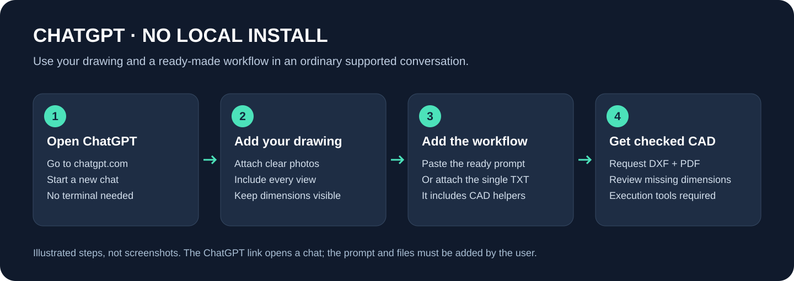

# Use TSBECM 202 directly in ChatGPT

[Project home](../README.md) · [All guides](README.md) · [Plugin routes](INSTALL_CHATGPT.md)

This route requires no local skill installation, Git command or terminal. You provide the instructions and the drawing in a normal conversation. Actual CAD file generation requires a chat that can read images, run Python and return files.



## Option A: one attachment with the full workflow

1. Download [TSBECM-202-ChatGPT.txt](../prompts/TSBECM-202-ChatGPT.txt) using the download button on its GitHub file page. If your browser displays the text, save it as a `.txt` file.
2. Open [ChatGPT](https://chatgpt.com/) and start a new conversation.
3. Attach the TXT file and the drawing images. Include every view and detail needed to understand the dimensions.
4. Send the request below.

```text
Use the attached TSBECM 202 workflow to reconstruct my technical drawing.
Read every view, dimension and annotation. Create a source ledger before
building geometry, and distinguish written, derived and unresolved values.

If you can execute Python and return files, create native editable DXF with
organized layers and DIMENSION entities, plus a scaled PDF preview.
Reopen and audit the saved DXF, check actual measurements and feature anchors,
and visually inspect the PDF. Return the files and an uncertainty note.

If execution is unavailable, explain that limitation and provide a complete
Python generator, dependencies and run commands. Do not claim that an output
file exists or was tested unless it was actually created and checked.
```

The attachment includes the actual workflow, three technical references, dependency list and CAD helper source. It installs nothing and does not connect to a separate project server.

## Option B: paste instructions, then attach your drawing

Copy [chatgpt-instructions.txt](../prompts/chatgpt-instructions.txt) into the conversation and attach your drawing. This is useful when downloading the larger TXT is inconvenient. The short prompt supplies the process; the full TXT also supplies the helper code and technical references.

## Prepare good source images

- Include the complete sheet before close-ups so the assistant can connect details to the correct view.
- Keep the camera as square to the page as possible and avoid glare or shadows over dimensions.
- Add close-ups of faint numbers, bolt patterns, profile labels and dimension endpoints.
- State the intended units if the sheet does not make them clear.
- Upload only material you are authorised to share with the selected host.

See the [drawing workflow](WORKFLOW.md) for how uncertain source information is handled.

## Check the result

| Output | What to inspect |
| --- | --- |
| Editable DXF | Native geometry, layers, text and measured dimension entities |
| PDF preview | Clear text, complete sheet, stated scale and no overlapping dimensions |
| Source ledger | Values linked to the source and feature endpoints |
| Verification note | Checks actually performed and information still unresolved |

Open the DXF in your CAD application. If DWG is needed, use a real CAD conversion or AutoCAD `SAVEAS`. Do not rename the extension.

## If the assistant only gives an explanation

Ask whether Python execution and file output are available in that conversation. If they are, ask it to run the generator and provide the actual files. If not, run the returned code in the documented [Codex/Python environment](INSTALL_CODEX.md). Pasting instructions cannot enable tools that the account does not have.

## Try an example first

Attach the [synthetic plate image](../examples/plate/source.png) and compare the result with the [reference example](../examples/plate/README.md). The [workshop drawing set](../examples/industrial-workshop/README.md) demonstrates a larger package generated from a dimensioned brief.

## Plugin availability

The downloadable plugin package is available in this repository. There is no verified public ChatGPT Plugins Directory listing yet. The direct-chat route works through attached instructions and does not require a directory listing. [Publication status](PLUGIN_PUBLICATION.md).
