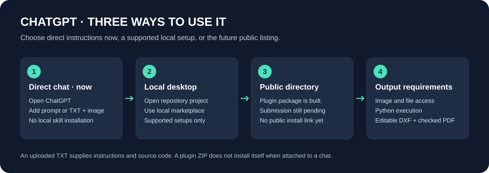

# TSBECM 202 in ChatGPT

[Project home](../README.md) · [Direct-chat quick start](CHATGPT_START.md) · [All guides](README.md)

## Choose a route

| Route | What it provides | Status |
| --- | --- | --- |
| Direct chat | Instructions and optional helper source attached to the conversation | Available now; host execution tools are required for files |
| Local desktop marketplace | A reusable plugin in a supported local ChatGPT/Codex setup | Package supplied; availability depends on the local client |
| Public Plugins Directory | A discoverable account-installed plugin | Not submitted or published |

## Direct chat: no local installation

Follow the [illustrated quick start](CHATGPT_START.md). Attach your drawing with [TSBECM-202-ChatGPT.txt](../prompts/TSBECM-202-ChatGPT.txt), then ask for editable DXF, a PDF and a record of unresolved dimensions.

An attached TXT or ZIP is not plugin installation. Instructions alone do not add image access, Python execution or file output capabilities.

## Supported local desktop setup

The project contains a local marketplace and a portable plugin:

- `.agents/plugins/marketplace.json`
- `plugins/tsbecm-202/plugin.json`
- `plugins/tsbecm-202/skills/draft-cad-from-images/`

Open the extracted repository in a supported local ChatGPT/Codex desktop environment. Use **Plugins** to find the local **TSBECM 202** marketplace and install the plugin. If your version does not expose local marketplaces, use direct chat or the [Codex CLI route](INSTALL_CODEX.md). Local installation in one environment does not install the plugin in every web or mobile account.

After installation, start a fresh conversation and select the plugin or its skill using `@` where supported. The technical skill name remains `draft-cad-from-images`.

## Future public directory listing

The plugin is a skills-only package: no hosted MCP server or separate project login is provided. It still relies on the host's file and Python tools. The official submission process requires the appropriate publisher identity, metadata and applicable checks.

When a genuine listing is published, this guide will link to it. Only then should users search for and install **TSBECM 202** from the public directory. [Current publication status and remaining work](PLUGIN_PUBLICATION.md).

## Expected deliverables

Ask for the actual DXF, a scaled PDF preview and a verification note. Compare the drawing with the source, especially the feature anchors of each dimension. The plugin does not install Autodesk AutoCAD or provide a licence. Native AutoCAD application testing must be reported separately from a DXF audit.

Official references: [Plugins](https://learn.chatgpt.com/docs/plugins), [Package format](https://developers.openai.com/plugins/build/plugins), [Submission](https://developers.openai.com/plugins/deploy/submission).
