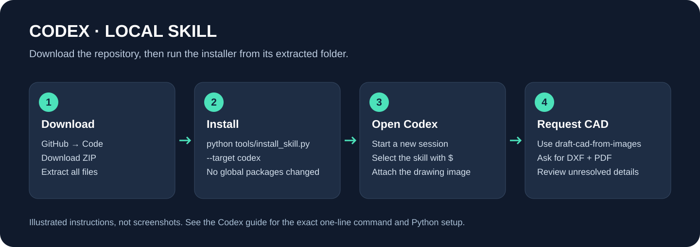

# الاستعمال فـCodex

[الصفحة الرئيسية](../README.md) · [English quick start](../README.en.md)



## 1. حمّل المشروع

استعمل [رابط النسخة الكاملة](https://raw.githubusercontent.com/mouniranna-ui/my-name/photo-to-autocad/downloads/photo-to-autocad-source-1.0.0.zip)، أو فـGitHub اختار الفرع `photo-to-autocad` ثم **Code → Download ZIP**، وفك الضغط. افتح Terminal فالمجلد اللي فيه `README.md` و`tools` و`plugins`. خاص Python 3.10+؛ `python --version` كيبين النسخة.

## 2. ثبت الـskill

```bash
python tools/install_skill.py --target codex
```

المكان الافتراضي هو `~/.agents/skills/draft-cad-from-images`. الأمر كيخدم بنفس الطريقة فـWindows وmacOS وLinux؛ استعمل `py -3` أو `python3` إذا لزم.

للتثبيت فالمشروع الحالي فقط:

```bash
python tools/install_skill.py --target codex --scope project
```

هاد الأمر كينشئ `.agents/skills/draft-cad-from-images` تحت المجلد الحالي. فـCodex Cloud، خاص هاد الملفات تكون فالمستودع أو البيئة اللي Codex خدام فيها، والصورة تكون متاحة لنفس الجلسة. تثبيت محلي فحاسوبك ما كيثبتش نسخة فبيئة سحابية أخرى.

## 3. جهّز مكتبات CAD

من مجلد المشروع، أنشئ بيئة Python وفعّلها حسب [الجدول فالصفحة الرئيسية](../README.md):

```bash
python -m venv .venv
```

فعّل `.venv` حسب نظامك، أو استعمل Python الموجود داخلها مباشرة، ومن بعد:

```bash
python -m pip install -r requirements.txt
```

قول لـCodex يستعمل نفس البيئة. ما تحتاجش API key إضافي خاص بهاذ المشروع؛ تسجيل الدخول أو اشتراك المنصة مسألة مستقلة.

## 4. جرّب

فتح جلسة جديدة، اختار `$draft-cad-from-images` أو ذكر الاسم بوضوح، وارفق الصورة. تقدر تبدأ بـ`examples/plate/source.png`، وتطلب:

```text
Use $draft-cad-from-images on the attached drawing.
Create native editable DXF, a PDF preview, and a source/uncertainty note.
Preserve all dimensions and annotations. Verify actual saved measurements.
```

تفقد DXF وPDF، خصوصاً ربط كل كوطاسيون بالعنصر الصحيح. [ملفات النتيجة المرجعية](../examples/plate/README.md) موجودة للمقارنة.

## Plugin اختياري

المستودع فيه `.agents/plugins/marketplace.json` وحزمة داخل `plugins/photo-to-autocad`. من جذر النسخة المحلية:

```bash
codex plugin marketplace add .
```

من بعد افتح Codex واستعمل `/plugins` فنسخة كتدعم هاد الواجهة، اختار marketplace ديال Photo to AutoCAD وثبّت الحزمة، ثم افتح جلسة جديدة. الـIDE ما كيدعمش plugins حسب الوثائق الحالية؛ استعمل طريقة skill مباشرة.

ما تثبتش نفس skill بالطريقتين إلا كنت محتاج نسختين؛ يقدرو يبانوا بجوج فالاختيار.

## التحديث أو الإزالة

```bash
python tools/install_skill.py --target codex --replace
```

المثبّت كيكتب مسار النسخة الاحتياطية. للإزالة اليدوية، احذف فقط مجلد `draft-cad-from-images` اللي طبعو المثبّت، بعد ما تحتافظ بتعديلاتك. ما تحذفش مجلد skills كامل.

توثيق المنصة: [مهارات Codex](https://learn.chatgpt.com/docs/build-skills) و[حزم وmarketplaces](https://developers.openai.com/plugins/build/plugins). راجع [المصادر وتاريخ المراجعة](SOURCES.md).
