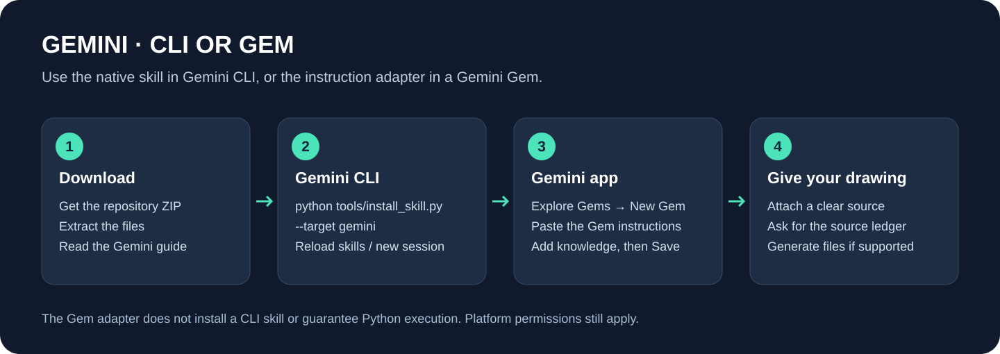
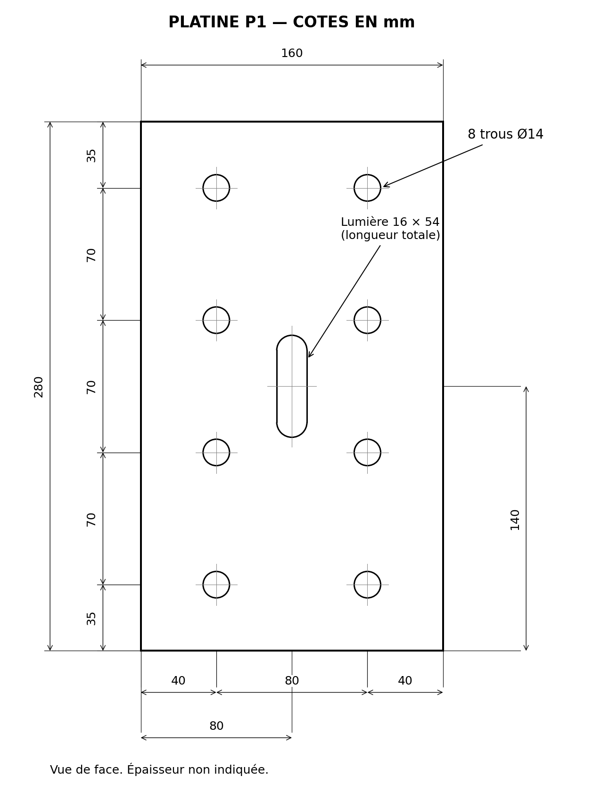

# الاستعمال فـGemini

[الصفحة الرئيسية](../README.md) · [English quick start](../README.en.md)



## Gemini CLI: تثبيت skill حقيقية

بعد تحميل المشروع وفك الضغط، من مجلد المشروع:

```bash
python tools/install_skill.py --target gemini
```

المثبّت كيحطها فـ`~/.gemini/skills/draft-cad-from-images`. فتح جلسة جديدة، أو استعمل داخل Gemini CLI:

```text
/skills reload
/skills list
```

يمكن كذلك استعمال المثبّت الأصلي ديال Gemini CLI من جذر المشروع:

```bash
gemini skills install ./plugins/photo-to-autocad/skills/draft-cad-from-images --scope user
```

اختار طريقة واحدة. راجع طلب الإذن اللي كتبيّنو المنصة. جهّز Python والمكتبات بالخطوات فالصفحة الرئيسية، وارفق الصورة أو عطِ مساراً متاحاً للجلسة:

```text
Use the draft-cad-from-images skill on this drawing.
Create editable DXF and a PDF. Read each dimension and its feature anchors,
and identify any information that the source does not specify.
```

إلا عندك نسختان بنفس الاسم فـ`.agents/skills` و`.gemini/skills`، Gemini كيستعمل ترتيب الأولوية الموثق عنده؛ تفقد `/skills list` باش تعرف المصدر اللي تحمّل.

## Gemini فالويب أو الهاتف: Gem بالتعليمات

1. من موقع Gemini، افتح **Explore Gems → New Gem**.
2. سمّي الـGem `Photo to AutoCAD`.
3. انسخ [gemini-gem-instructions.txt](../prompts/gemini-gem-instructions.txt) فخانة التعليمات.
4. يمكن تزيد [portable-knowledge.txt](../prompts/portable-knowledge.txt) تحت **Knowledge**.
5. جرّبها بالصورة، ثم اضغط **Save**. المعاينة بوحدها ما كتحفظش الـGem.



الـGem كتستعمل التعليمات والمعرفة؛ هادي ماشي نسخة Gemini CLI وماشي تثبيت للمكتبات. إلا ما قدرتش تنفّذ Python وترجع ملفات، خاصها تسلّم لك برنامجاً وجدول القياسات باش تشغّلو محلياً. ما نعتابروش كوداً مكتوباً ملف DXF تم توليدو واختبارو.

## تثبيت Gemini CLI نفسه

هاد المشروع كيضيف skill لـGemini CLI؛ ما كيثبتش Gemini CLI ولا كيضبط حساب Google. اتبع [دليل البداية الرسمي](https://geminicli.com/docs/get-started/)، ثم رجع لخطوات هاد الصفحة.

المراجع: [Agent Skills](https://geminicli.com/docs/cli/skills/)، [أوامر CLI](https://geminicli.com/docs/cli/cli-reference/)، [إنشاء Gems](https://support.google.com/gemini/answer/15235603?hl=en).
