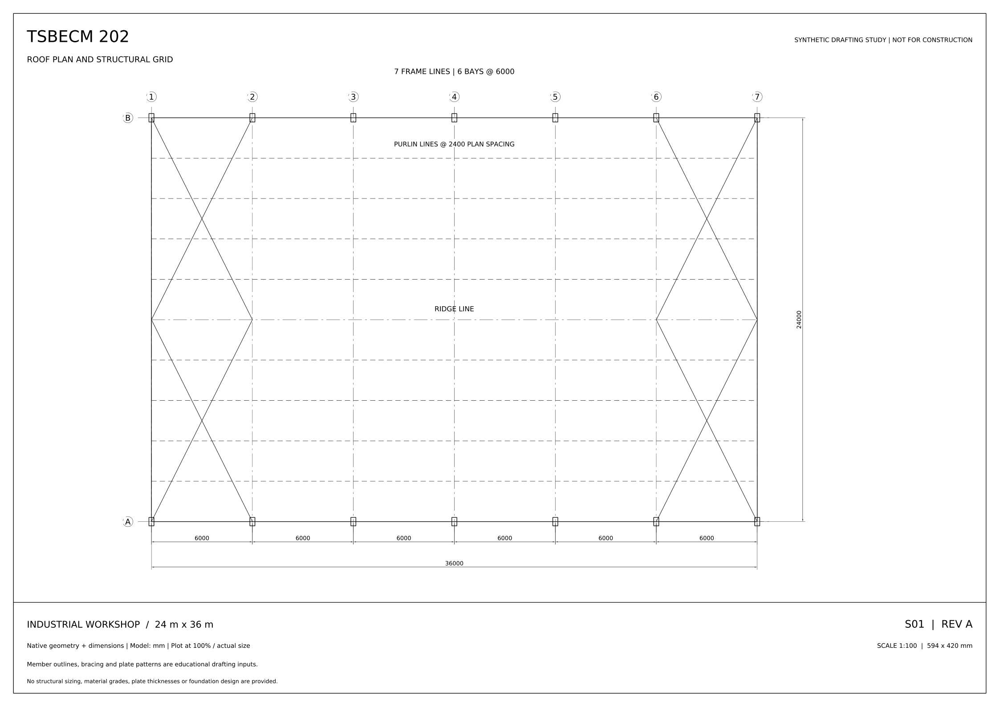
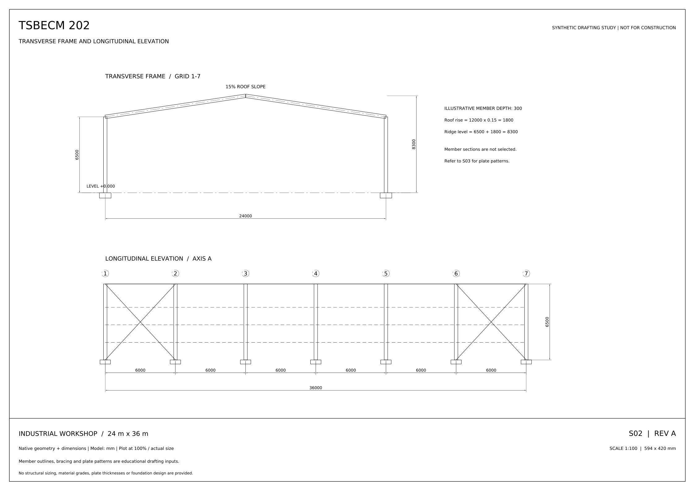
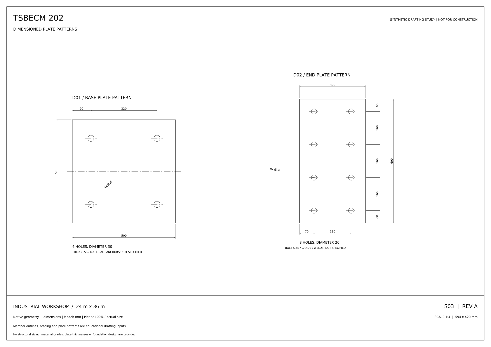

# Industrial workshop: a coordinated CAD demonstration

[TSBECM 202](../../README.md) · [Verification guide](../../docs/VERIFICATION.md)

A **24 m × 36 m synthetic educational workshop study** showing how the drafting tools produce a coordinated, dimensioned drawing set. This example starts from the published specification, not a photograph or a client project.



## Drawing set

| Sheet | Contents | Editable CAD | PDF |
| --- | --- | --- | --- |
| S01 | Roof plan, structural grid, frame lines and bracing illustration | [DXF](S01_roof_plan.dxf) | [PDF](S01_roof_plan.pdf) |
| S02 | Transverse frame and longitudinal elevation | [DXF](S02_elevations.dxf) | [PDF](S02_elevations.pdf) |
| S03 | Dimensioned base-plate and end-plate hole patterns | [DXF](S03_plate_details.dxf) | [PDF](S03_plate_details.pdf) |

**[Download the complete three-page PDF](TSBECM-202_Workshop_Drawing_Set.pdf)**. All sheets use A2 landscape paper. S01 and S02 plot at 1:100; S03 plots at 1:4. Print at actual size rather than fitting the PDF to a different paper size.

| Elevations | Plate patterns |
| --- | --- |
|  |  |

## Source specification

| Parameter | Value |
| --- | --- |
| Building span | 24,000 mm |
| Building length | 36,000 mm |
| Structural grid | 7 frame lines; 6 bays at 6,000 mm |
| Eaves height | 6,500 mm |
| Roof slope | 15% |
| Derived rise | 12,000 × 0.15 = 1,800 mm |
| Derived ridge level | 6,500 + 1,800 = 8,300 mm |
| Base-plate pattern | 500 × 500 mm; 4 holes, diameter 30; 90 mm edge distance |
| End-plate pattern | 320 × 600 mm; 8 holes, diameter 26; 180 mm column pitch |

See [specification.json](specification.json) for the complete inputs. Profile outlines and bracing are schematic. Loads, member selection, material grades, plate thicknesses, bolt grades, welds, foundations and fabrication tolerances are deliberately not specified.

## Verification

The saved files contain **34 native dimension entities**: eight in S01, eleven in S02 and fifteen in S03. All three saved-file audits reported zero errors and zero automatic fixes. The build also checks all twelve plate-hole positions independently, the bay total and the derived ridge height.

- [Combined verification record](verification.json)
- S01: [expected checks](S01_roof_plan.checks.json) and [audit](S01_roof_plan.audit.json)
- S02: [expected checks](S02_elevations.checks.json) and [audit](S02_elevations.audit.json)
- S03: [expected checks](S03_plate_details.checks.json) and [audit](S03_plate_details.audit.json)

The preview images come from the actual DXF-generated PDFs. They are not screenshots from Autodesk AutoCAD. Numerical consistency with a synthetic brief does not establish structural adequacy, fabrication readiness or photo-reading accuracy.

## Reproduce the package

From the repository root, after installing its Python dependencies:

```bash
python tools/build_showcase.py --output-dir workshop-output
```

The generator creates three DXFs, individual PDFs and PNGs, a combined PDF, check manifests and audit records. Keep the specification and generator with the output so another person can reproduce the result.
